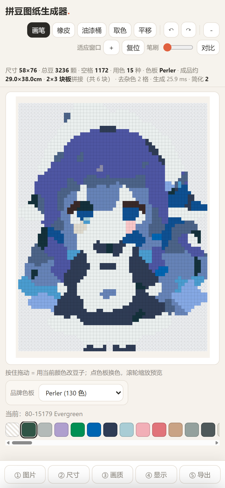
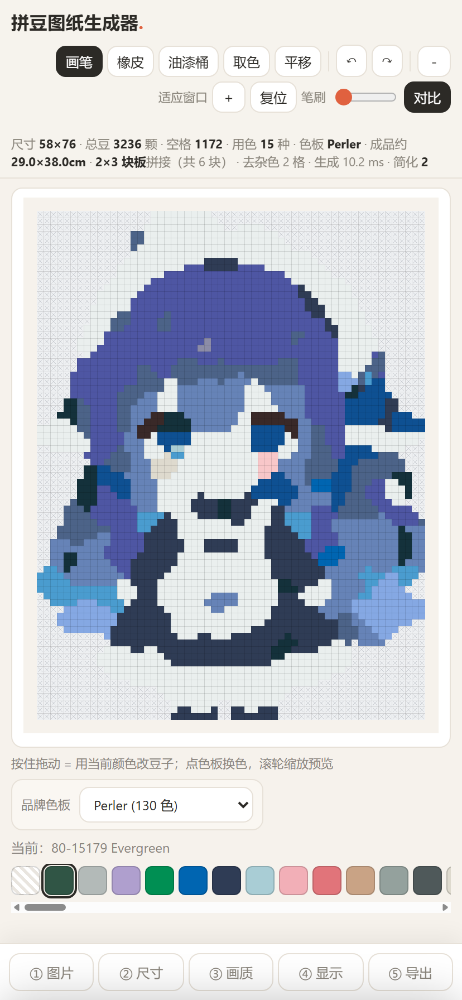
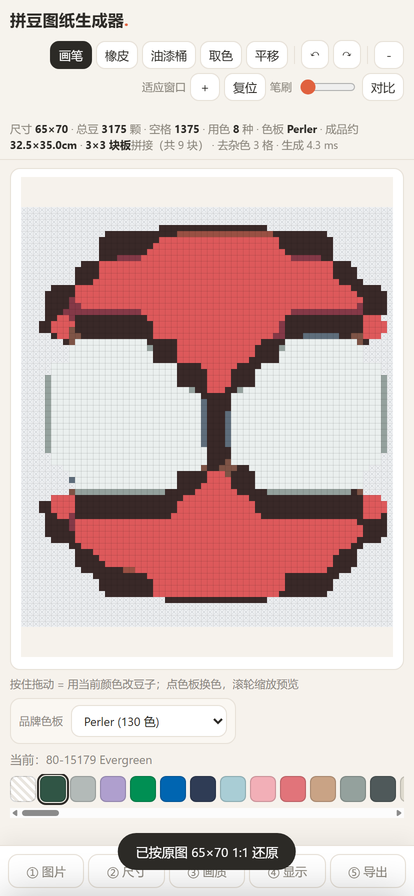
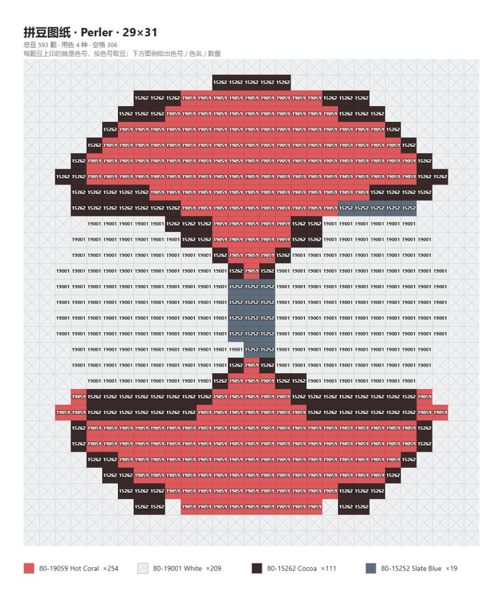

# 拼豆图纸生成器 (Perler Bead Pattern Generator)

把本地图片转成拼豆（perler / hama / artkal 等熔珠）图纸的网页工具。**纯本地运行，无需安装、图片不上传。**

## 在线预览

👉 [https://perler.wildcode.cn/](https://perler.wildcode.cn/)（自定义域名）

备用地址：[https://kbrown102.github.io/perler-bead-generator/](https://kbrown102.github.io/perler-bead-generator/)

## 截图

**主界面（手机端：顶部工具 / 中部图纸 / 底部步骤条）**



**按住「对比」看未简化版**（松手恢复，可判断简化减得够不够）



**像素画 1:1 还原**（65×70 图标 → 8 色，线条干净）



**导出的图纸**（每颗豆上印色号 + 下方色号清单，可直接照着拼）




## 快速开始

直接双击打开 `index.html` 即可（无需服务器、无需构建、无任何依赖）。

## 功能

**界面（手机端优先，三层结构）**
- **分层**：图纸画布（最底）→ 主界面 UI（顶部工具条 / 底部步骤条 / 色板）→ 工具展开面板（最上，遮罩 + 上滑）
- **顶部 = 编辑工具**：画笔 / 橡皮 / 油漆桶 / 取色 / 平移 + 撤销重做 + 缩放 −/＋/复位 + 笔刷 + **对比**（按住看未简化版）
- **底部 = 步骤条**：① 图片 / ② 尺寸 / ③ 画质 / ④ 显示 / ⑤ 导出，点哪步就从底部展开对应面板
- **主界面直接选品牌色板**（画布下方、当前用色上方），下面是横向滚动的选色条（超宽也不撑破页面）
- 面板从底部上滑，顶部中间有「收起」把手；点把手 / 点遮罩 / Esc 都能收起
- **显示与导出拆成两页**：网格线、分板、适应窗口、预览缩放、色号清单归「显示」；「导出」只留导出按钮 + 当前图纸摘要

**输入与网格**
- 上传图片 / 拖拽 / 示例图
- 网格化：宽度 8–150，高度按比例自动，可选正方形标准板；支持**锁定尺寸后换图不重置**
- 常用尺寸模板：钥匙扣 8×8(≈4cm) / 12×12 / 胸针·冰箱贴 16×16、20×20 / 杯垫 24×24 / 标准小板 29×29(14.5cm) / 中板 29×58 / 大板 58×58 / 大图 87×87 / 超大 116×116
- 模板长宽比与原图不同时：等比留白（默认，不拉伸）/ 等比裁切 / 拉伸三选一
- **分板显示**：粗线画出每块板边界 + A1/B2 编号，统计里直接写「成品约 58.0×58.0cm · 4×4 块板拼接（共 16 块）」
- 豆子规格可切 5mm 中豆（板 29×29 = 14.5cm，三品牌通用）/ 2.6mm 迷你豆（板 52×52 国产常见 / 50×50 Artkal，两种不兼容），成品尺寸 = 豆数 × 节距（5.0 / 2.6mm）自动换算

**做减法：采样 → 简化（核心画质链路）**
- **采样默认「主色众数」（majority）**：每格取源图小块里出现最多的颜色，平坦区不被抗锯齿/渐变带偏（同一张插画：25 色 / 333 色块 → 15 色 / 121 色块，孤立单格 134 → 23）
- **大块简化 `region.js`**：同色 4 连通块标号 → 面积过小的碎色块**整块并进共享边界最长、色差最小的邻居** → 相邻块色差合并。实测大肥鱼 58×76：色块 183 → **96**（默认 2 档）/ **65**（3 档），孤立单格 59 → 4
- **简化强度按尺寸自动推荐**：≤14 格 → 3、≤24 格 → 2、≤120 格 → 2、更大 → 1；HUD 标「简化 2（自动）」。**手动拖过滑杆就换成你的值**（之后改尺寸不会被自动覆盖）
- **按住「对比」看未简化版**：按住顶部「对比」按钮时用 `simplifyLevel=0` 重跑一遍出图，松手恢复原样（不改任何参数）
- **HUD 细节保留度**：开启简化时统计「单格细节」（四周没有同色邻居的孤豆）的简化前后数量，如 `细节 524→4`
- **画质预置**：干净（推荐，照片/插画）/ 像素风（小图 1:1 还原）/ 均衡 / 细节优先；**换图自动恢复默认预设**，不把上一张的参数带过去
- 抖动默认关闭（杂点太脏），需要渐变过渡时再开；算法 Floyd–Steinberg / Atkinson / Stucki / Burkes / Sierra，强度 0–100%
- 原图平滑降噪（边缘保持，0–3 遍）、相似色合并（Oklab 阈值）、图纸平滑（3×3 众数，像素风 2 遍）、k-means 颜色数量上限、Oklab / RGB 两种色差

**像素画：识别、还原与保护**
- **像素网格检测**：列/行跳变剖面 + 相位扫描，自动求像素块周期与偏移，支持**被裁切/偏移**的像素画（实测 6 倍放大且偏 3px → 周期 6、相位 3,3、还原 100% 一致）
- **一键按原生像素还原**：放大过的像素画点「对齐到 65×70（1 豆 = 原图 1 像素）」→ 原生尺寸 + 像素风参数
- **像素风小图识别**：≤150×220 且有大块完全平涂、颜色密度低时提示「这是像素画」，一键切 1:1（65×70 图标：58×62 / 17 色 → 65×70 / 8 色）
- **像素画必须关简化**：像素风预设把大块简化固定为 0；手动调高时建议卡提醒「关掉简化」（实测 1:1 下简化 0→2，单格细节 11→1）
- **只认"精确边界"**：整像素倍数放大/原生像素画才做 1:1；双线性/AI 平滑放大不谎报，交给众数采样 + 大块简化处理

**背景与成品形态**
- **自动去背景（异形成品）**：载入时识别四边主色（含"白+浅灰棋盘格假透明"），四边洪水去底 → **成品自动异形空豆**；实测大肥鱼 4408 → **3131 颗（省 1277，−29%）**
- 手动「去背景色（本地）」（任意纯色底，含棋盘格）、「自动裁掉空白边」、**「撤销原图处理」**
- 图片页有开关：载入时自动去背景（默认开，可关）

**载入建议卡（替代会消失的 toast）**
- 一次给一条最值得做的建议 + 一键执行：像素画 → 按原图 1:1 还原；放大像素画 → 对齐原生像素；小尺寸 → 最大简化；碎色 → 大块简化；像素画开了简化 → 关掉简化；背景还在 → 去背景

**图纸上直接编辑（单一视图）**
- 只有一个图纸视图，所有编辑直接在图纸格子上做（早先的「编辑原图」页签已移除）
- 画笔（1–4 格笔刷）/ 橡皮 / 油漆桶 / 取色，支持拖动连续画；点色板或点色号清单即可选色，悬停高亮当前格
- 图纸可**缩放/平移**：滚轮以鼠标为中心缩放、`－/＋` 以视口中心缩放、`平移` 工具或右键拖动、`复位` 回到适应窗口；放大后画笔落点按缩放换算
- 图纸编辑独立撤销 / 重做栈；手动改的格子叠在自动结果之上，换参数也保留（换网格/色板才重置）

**自动处理**
- **自动描边**：可勾选/取消；位置可选 外扩 / 内描边 / 内外都描，描边色自动取**近黑中性色**（也可指定），粗细 1–3 格可调；开启「自动识别背景」后，白底/纯色底的不透明图片也能正确描边
- **自动去杂色**：只清「被单一颜色明显包住」的孤立小连通块（8 邻域 + 邻域主色 ≥62% 才动），避免把脸、眼睛高光抹平；阈值 ≤N 格（1–6）可调；开启时自动关抖动
- **熨烫（烤完）预览**：按熔珠压扁后的观感换算颜色（对比度变平、饱和微降、深色提亮/浅色压暗），强度 0–100%；图纸以圆角熔珠 + 高光呈现，色号清单同时显示「原色 / 烤后色」两个色块

**颜色与输出**
- 多品牌色板（Perler / Hama / Artkal / Mard 221·291 / Nabbi / Yant …），透明区域 = 空格（不放置豆子）
- **豆上直接印色号**（如 `C29`、`M22`），长色号自动简写（`80-15245 → 15245`），字号按格子宽度自适应 + 反色描边保证可读
- 色号**始终显示**（预览和导出都印），没有开关；预览格子 <18px 时自动不画，避免糊成一片
- 色号清单（在「显示」页）：色块 + 色号 + 色名 + 数量；导出图里也带同样的清单
- **只导出图纸 PNG**（含色号清单、尺寸信息、跟随熨烫预览）；1:1 像素图导出、复制购物清单等旁路功能已移除
- 统计只给**豆子总数 / 空格数 / 用色数 / 成品尺寸 / 分板数**，不猜"买几袋"（各厂包装规格不一）

## 精确色号

`palettes.js` 由开源色号库 [maxcleme/beadcolors](https://github.com/maxcleme/beadcolors) 生成（BeadSurge / Kandi Pad 等拼豆软件在用）。

如需重新生成或更新色号，在本目录执行：

```powershell
.\import-palette.ps1
```

## 调研资料

- `research/competitor-features.md`：20+ 个拼豆工具的横向调研（BeadSurge / Kandi Pad / Beadifier / MakeBead / Beadify / Stitchmate / MyBeadPattern / pindou.art / 轻图 …），含功能矩阵、四个重点功能的业界做法、与我们的差距清单（P0/P1/P2）
- `research/boards-and-apps.md`：拼豆板尺寸规格与中文 App 调研（29×29 = 14.5cm、52×52 / 50×50 迷你豆不兼容等）
- `research/bead-algorithm-videos.md`：B 站 30+ 视频的方法论提炼（FFT 网格检测 + 逐格众数、社区不用抖动、去背景省豆 −24.5% 等），带 ✅/🟡/⚪ 置信度

## 代码结构（模块化重构）

`index.html` 从 2800+ 行拆成 **336 行 DOM 壳 + 3 个样式文件 + 24 个脚本模块**（共约 3000 行 JS），零构建、仍然双击即用：

```
index.html                 只留 DOM 壳 + 按顺序引入
styles/base.css            变量/重置/基础件
styles/components.css      面板/图例/色板/画布
styles/layout-mobile.css   手机端布局（顶部工具条 + 底部步骤条 + 上滑面板 + 建议卡）

src/util.js                工具函数（含色号简写 shortCode）
src/perf.js                PerfMeter 类 + debounce/rafThrottle
src/history.js             History 类：通用撤销/重做栈（图纸 60 步 / 原图 12 步）
src/viewport.js            Viewport 类：缩放/平移数学（不碰 DOM）
src/state.js               唯一可变状态源
src/dom.js                 DOM 引用集中管理
src/palette.js             色板数据与下拉
src/color.js               Oklab 色差 / 最近色 / 熨烫色值
src/image.js               源图：载入、像素网格检测（周期+相位）、降噪、采样（众数/平均/最近邻/对齐）
src/quantize.js            抖动核、k-means 限色、并色、众数平滑
src/region.js              区域简化 RegionSimplifier 类 + 单格细节统计 + 尺寸自适应强度
src/outline.js             背景识别、自动描边、去杂色
src/pipeline.js            渲染管线（阶段化 + 计时）：采样→限色→量化→并色→简化→平滑→合成
src/legend.js              色号清单 / 色板条 / HUD 统计
src/renderer.js            图纸渲染（离屏缓存 + 视口）
src/editor.js              图纸编辑（手势分发 + 撤销栈）
src/tools.js               工具类：GridTool → Brush/Eraser/Fill/Pick/Pan（策略 + 继承 + 注册表）
src/exporter.js            导出图纸 PNG（含色号清单）
src/source-ops.js          去背景（含棋盘格识别）/ AI 抠图 / 裁边 / 撤销
src/sheet.js               底部上滑面板 + 步骤条联动
src/suggest.js             载入建议卡（SuggestionCard 类）
src/compare.js             按住对比（ComparePreview 类）
src/panels.js              参数控件绑定
src/app.js                 启动装配
```

- 设计模式：**策略 + 继承**（编辑工具）、**工厂 + 注册表**（工具表）、**模板方法**（渲染管线阶段）、**备忘录**（History 撤销栈）、**单例**（viewport / perf / suggestions / comparePreview）
- 性能：状态分层避免整条管线重算、离屏画布缓存 + 显式失效、rAF 合并重绘、拖动期间缓存 `getBoundingClientRect`、色板 Oklab 用 WeakMap 缓存、TypedArray 存网格、管线各阶段计时并显示在 HUD（58×76 约 20–30ms）
- 详细说明见 [docs/ARCHITECTURE.md](docs/ARCHITECTURE.md)，工程规范见 [docs/ENGINEERING-RULES.md](docs/ENGINEERING-RULES.md)，git 用法见 [docs/GIT-使用指南.md](docs/GIT-使用指南.md)

## 技术说明

- 无框架、无依赖、无构建（普通 `<script>` 顺序加载，`file://` 也能跑，PWA/Capacitor 同样可用）
- 核心算法链：**众数采样** → 感知色差匹配（Oklab，可含误差扩散）→ 限色/并色 → **区域简化（做减法）** → 众数平滑 → 去杂色 → 描边 → 手动编辑叠加
- 像素画走另一条支线：网格周期+相位检测 → 还原原生尺寸 → 1:1 采样（并固定关闭简化）
- 后续可复用核心逻辑打包到桌面（Electron/Tauri）、移动端（Capacitor）、微信小程序（Canvas 2D）

## Android App（一键打包）

本项目已内置 [Capacitor](https://capacitorjs.com/) 配置，可把网页版直接套壳成 Android App：

1. 安装 [Node.js](https://nodejs.org/) 和 [Android Studio](https://developer.android.com/studio)（内含 JDK 与 Android SDK）
2. 双击运行 `build-android.bat`
3. 完成后 APK 在 `android\app\build\outputs\apk\debug\app-debug.apk`，传到手机安装即可

目录说明：

```
perler-bead-generator/
├── index.html  palettes.js  sw.js  manifest.json  CNAME   ← Web 源码（GitHub Pages / 自定义域名）
├── capacitor.config.json                                 ← Capacitor 配置
├── package.json                                          ← Node 依赖
├── build-android.bat                                     ← 一键打包脚本
├── www/       ← 构建时生成（不提交）
└── android/   ← 构建时生成（不提交）
```

> 说明：`www/`、`android/`、`node_modules/` 均为构建产物，已加入 `.gitignore`；首次打包会联网下载依赖与 Gradle，耗时较长。当前为 debug 签名包（可直接安装）；上架应用商店需另行配置 release 签名。

## 版本

- `v1.0`（2026-11）：界面分层重构 + 像素化质量升级（众数采样 / 大块简化 / 像素画保护 / 建议卡 / 对比 / 细节度 / 自动简化强度）。用 `git show v1.0` 查看该版本。

## License

本项目使用 MIT License，详见 [LICENSE](./LICENSE) 文件。
